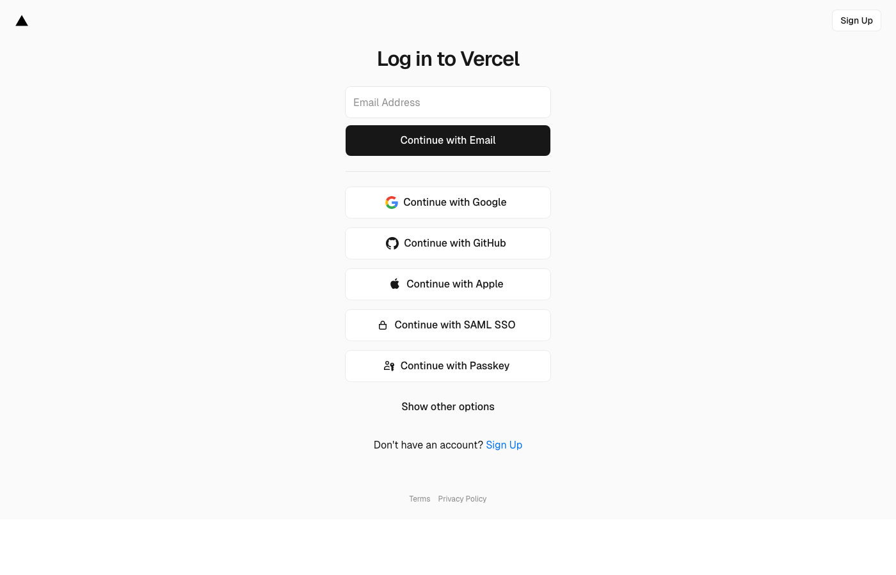
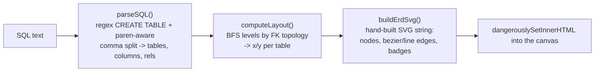

<div align="center">

# ERD++

Paste SQL `CREATE TABLE` statements and get a polished ER diagram.

[](package.json)
[](package.json)
[](tsconfig.json)
[](tailwind.config.ts)
[](LICENSE)

**Live -> [erd-bheng.vercel.app](https://erd-bheng.vercel.app)**



</div>

## Features

- **SQL schema input** - paste `CREATE TABLE` statements (Postgres, MySQL, SQLite, SQL Server-style quoting) and watch the diagram render live as you type.
- **Relationship detection** - inline `REFERENCES`, table-level `FOREIGN KEY (...) REFERENCES ...` (including composite keys), and table-level `PRIMARY KEY (...)` are all parsed; duplicate relationships are deduped automatically.
- **Custom relationship labels** - label an edge inline with a trailing `-- comment`, or declare a whole set up front in an `-- @rels` block (`parent -> child : label`).
- **Automatic hierarchical layout** - tables with no incoming foreign keys become the top row; children are placed one level below their parent via a breadth-first pass, and each row is centered under the widest row.
- **Colorful, readable nodes** - each table gets a color from a fixed 12-color palette, a rounded card, PK/FK badges, zebra-striped rows, and optional column types.
- **Curved (or straight) relationship arrows** with one-to-many notation - hash marks at the "one" end, an "N" at the many end - fanned out across the parent edge when a table has multiple children.
- **Pan & zoom canvas** - click-drag to pan, Ctrl/Cmd+scroll to zoom, a floating toolbar with +/-, 50/75/100/150% presets, and Fit-to-view.
- **Live style & layout controls** - toggle colored headers, column types, relationship labels, curved vs. straight arrows, and a dark canvas background; tune table width, row height, header height, and gaps with sliders.
- **Resizable, themeable SQL editor** - drag-to-resize panel, independent light/dark toggle, copy-to-clipboard.
- **Export** - 2x-retina PNG, raw SVG, the SQL source, or the parsed schema as JSON.
- **Local persistence** - your schema, style options, and layout settings are saved to `localStorage`, so a refresh picks up where you left off.
- **Mobile responsive**, fully client-side - no backend, no database, no account.

## How it works

`app/page.tsx` is a single client component that runs a four-stage pipeline on every keystroke, memoized with `useMemo`:



- **Parse** - `parseSQL` first splits each `CREATE TABLE` body on top-level commas (tracking paren depth and `--` comments so nested types like `NUMERIC(10,2)` survive), then reads primary keys, foreign keys (inline and table-level), and column types off the remaining lines.
- **Layout** - `computeLayout` builds a parent/child map from the detected relationships, assigns each table a level by walking from root tables (no parents) outward, and lays out each level as a centered row.
- **Render** - `buildErdSvg` emits one raw SVG string by hand (no diagramming library): rounded table cards with a colored header, PK/FK markers, zebra rows, and cubic-bezier or straight connector paths with crow's-foot-style "one" ticks and an "N" label at the many end.
- The same SVG string is rasterized to PNG (via an offscreen `<canvas>`) for export, or downloaded as-is for the SVG option.

There is no server component and no API route - `next.config.ts` builds the app with `output: "export"`, so the whole thing ships as static HTML/JS/CSS.

## Tech stack

| Layer | Tech |
|---|---|
| Framework | Next.js 15 (App Router), static export (`output: "export"`) |
| UI | React 19, TypeScript (strict mode) |
| Styling | Tailwind CSS |
| Icons | lucide-react |
| Diagram rendering | Hand-built SVG string builder - no charting/diagram library |
| State | React hooks + `localStorage`, no backend or database |
| Hosting | Vercel |

## Getting started

```bash
git clone https://github.com/bunlongheng/erd.git
cd erd
npm install
npm run dev
```

Open [http://localhost:3003](http://localhost:3003) and paste a schema into the SQL panel.

| Script | Description |
|---|---|
| `npm run dev` | Dev server on port 3003 |
| `npm run build` | Static production build |
| `npm run start` | Serve the production build |
| `npm run lint` | ESLint |

---

<div align="center">

<a href="https://bunlongheng.com"></a>
<a href="https://www.linkedin.com/in/bunlongheng/"></a>
<a href="https://www.instagram.com/ibunlong/"></a>
<a href="mailto:bheng.code@gmail.com"></a>

<br>

Built by **[Bunlong](https://bunlongheng.com)** &nbsp;&middot;&nbsp; [more apps](https://bunlongheng.com/projects)

</div>
